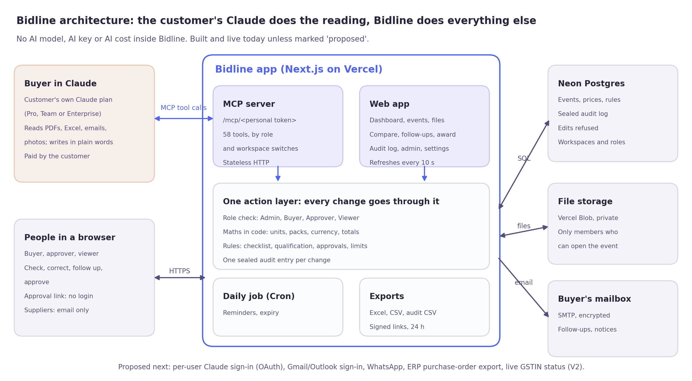

# Bidline

**Claude reads the supplier quotes. Bidline does the maths, keeps the record and gets it approved.**

Live app: **https://bidline-app.vercel.app** · Built for the Volopay Product & Tech assignment.

| Read | What it covers |
|---|---|
| [Features](docs/FEATURES.md) | Every feature and what it does, in plain words |
| [How it is used](docs/USER-FLOW.md) | Who uses it, the first-time flow, one event start to finish, a day with Bidline |
| [Architecture](#architecture) | Diagram, data flow, who does what, built versus proposed |

**At a glance:** Next.js 16, React 19, Tailwind 4, Neon Postgres, Vercel Blob and Cron, and an MCP server with 58 tools. Checked by a no-AI scan, type and lint checks, a calculator test (150 of 150 prices match a reference snapshot) and an end-to-end test that drives the whole flow through MCP.

Bidline is a procurement workspace. Each purchase is a **sourcing event** (an RFQ by default, or an RFP, RFI or tender). A buyer asks three to five suppliers for quotes. The replies come back as a spreadsheet, a PDF, a Word letter, an email and a phone photo of a rate card. Today someone retypes all of it into one sheet before anyone can compare a price, and a "box of 10" priced per piece quietly makes the wrong supplier win.

Bidline is the system of record around the buyer's own Claude:

- **Claude** (the customer's own plan, connected over MCP) reads each supplier document and reports what it says: the price exactly as written, in the supplier's unit and currency, with their own words and where they appear.
- **Bidline** stores it, converts units and currencies, works out landed prices, ranks them, decides questionnaire pass or fail, lists what each supplier still owes, and drafts an award note that the approver signs off on a link. A person can open the app, see everything Claude created, and change it, on the record.

**There is no AI inside Bidline.** No model SDKs, no AI keys. `npm run check:no-ai` proves it.

---

## Try it

1. Sign in at https://bidline-app.vercel.app and create an account (reviewers have a test login).
2. Answer the first question, "How would you like to start?":
   - **Use demo data:** loads three fictional events: an IT hardware RFQ with 12 supplier files waiting for Claude, office furniture already compared and approved, and housekeeping supplies with quotes partly in and a follow-up overdue.
   - **Use my own files:** tell Claude what you are buying (or fill a short form, or use a template), then upload supplier replies (PDF, Excel, Word, email, photos).
3. Connect Claude. The next popup walks you through it and confirms "Claude MCP connected" as soon as Claude reaches Bidline. The link is also on the **Ask Claude** page.
   - **Claude on the web or desktop:** Settings, then Connectors, then *Add custom connector*. Name it Bidline, paste the link, add. In a chat, switch Bidline on from the tools menu.
   - **Claude Code:** `claude mcp add --transport http bidline <your link>`
4. Ask Claude, for example:
   - "Use Bidline: read every unread supplier document on my latest enquiry and submit what each one says."
   - "In Bidline, what needs my attention before I can compare these quotes?"
   - "Using Bidline's numbers only, who should win if we only award to qualified suppliers?"
   - "Chase every supplier for what they still owe."
   - "Draft the award on the qualified basis and give me the approval link."
5. Watch the enquiry page update by itself. Click any price to see where it came from, every step that turned it into a landed price, and its history. Correct it with a reason; the original reading is kept.

## What a person can do in the app

| Area | What it does |
|---|---|
| Home | Organisation dashboard: key figures, pipeline by stage, ways to save, what needs attention, recent activity. A second tab, My work, is the person's own queue; items can be assigned to a teammate or snoozed |
| Sidebar | Home, Pinned (drag to reorder, starred events), Sourcing (views by stage, suppliers), Insights (spend analytics, audit log), Claude (Ask Claude, tools), Organisation (admins), the open event's sections, and an account menu with the organisation and role |
| Search and alerts | ⌘K search over events, suppliers, documents and line items; a notification bell; optional email notifications and Slack, Teams or webhook alerts |
| All events | Views (needs attention, by stage, awaiting approval, archived) with counts, search, owner and sort, all kept in the link |
| Event page | Steps as tabs with counts (each person can reorder or hide them), a "Next" banner, Star, Access (restrict to named people), Duplicate, Archive, Export, and the audit trail fixed on the right |
| Teams and roles | Workspaces with Admin, Buyer, Approver and Viewer roles, invites, restricted events. Approvers decide inside the app; nobody approves their own award; requests expire after a set time; extra approval steps above set values; a limit on one supplier's share of an award |
| Audit log | Organisation-wide and per event, with filters, CSV export and a sealed hash chain that shows any edited or deleted entry. Entries cannot be edited |
| Suppliers and spend | A supplier directory across events (reply rate, wins, corrections) and spend analytics against budget, for all events or one |
| Overview | Charts from the same figures as the grid: price against budget, lines won, quote quality, spend by category (each with a table view) |
| Audit trail | Side panel: every change on the event, who made it (Claude, the buyer, the approver), when, and the before and after values. Read-only |
| Ask Claude | Instant answers worked out in code (cheapest, savings against budget, price differences, categories, qualification, what is owed, a line, a supplier); your connector link; questions to ask Claude; every supplier file by event |
| Settings | Profile; preferences (number and date format, time zone); notifications; your own mailbox for supplier follow-ups (SMTP with an app password, checked before saving, stored encrypted); Claude links; Storage (files and sizes by event). Admins also get Organisation, Team and roles, Approvals and reminders, and Security and data. Tool switches are on the Claude tools page |
| Comparison | Line by supplier grid of landed prices per asked unit. Lowest comparable price highlighted; caveats, prices needing a person and missing prices marked without relying on colour alone |
| Cell drawer | Supplier's words, document and location, each conversion step, flags (including unusually high or low prices), correction with reason, undo, comments, history |
| Documents | Grouped by supplier, with filters and search; drag and drop files; assign supplier and kind; open the original |
| Lines | Edit what Claude created: items, units, pack sizes, quantities, budgets. Vague lines are flagged before issuing. Notes on any line |
| Suppliers | Contacts, status, terms as read, stated totals, conditional offers |
| Questionnaire | Pass, fail or not assessed per question, with the sentence that decided it. Remove a question with a reason |
| Follow-ups | Pick a supplier: what they still owe, and the email that asks for it with Send on top. Automatic reminders, up to three per follow-up, once an admin switches them on |
| Award | Award options with like-for-like restatement; award note and approval link; withdraw an award awaiting approval |
| Rules & items | Exchange rates, unit rules, prior-order rates, items that match no line |
| Exports | Comparison as Excel (with an audit-trail sheet) or CSV |

## MCP tools (58; 57 on by default)

All tools, what each does and whether it reads or changes, are listed in the app under Claude tools, where an admin can switch any of them off for the workspace. A person's Claude is offered only the tools their role allows; a read-only connector link offers reading tools only.

Orientation: `get_started`, `list_rfxs`, `list_open_work`, `get_rfx`. Enquiry: `create_rfx`, `duplicate_rfx`, `update_rfx`, `upsert_lines`, `add_line_note`, `add_questions`, `remove_questions`, `issue_rfx`, `add_suppliers`, `update_supplier`. Reading: `list_documents`, `read_document`, `save_document_text`, `submit_quote`, `submit_questionnaire`, `submit_second_read`. Analysis: `get_comparison`, `get_line`, `explain_cell`, `get_supplier`, `list_needs_attention`, `compare_award_options`, `what_if`, `price_history`. Changes: `correct_price`, `set_fx_rate`, `add_unit_rule`, `set_prior_po_rates`, `record_assumption`, `resolve_unmatched_item`. Follow-ups: `get_chase_list`, `email_supplier` (draft, or send from the buyer's connected mailbox), `record_chase`, `update_follow_up`. Documents also: `update_document`. Award: `create_award`, `withdraw_award`, `get_award_status`. Exports and history: `get_export_link` (24-hour download link for the Excel, CSV or activity log), `get_activity`. Across events: `search_bidline`, `supplier_scorecard`, `spend_summary`, `flag_unusual_prices`, `set_budget`, `archive_rfx`, `comment_on_price`, `check_ready`, `check_gstin`, `list_team`, `save_template`, `list_templates`, `create_rfx_from_template`, `decide_award`.

Every tool accepts an optional `user_request`, the message that led to the call, which is kept in the transcript.

## Architecture



### Data flow

1. The buyer asks Claude in plain words, for example "Create a sourcing event for 40 chairs and invite Featherline".
2. Claude calls a Bidline tool over MCP at the buyer's private link. The link identifies the person.
3. The one action layer (`lib/actions.ts`) checks the person's role, saves to Postgres and writes one sealed audit entry. Every change, from Claude or the app, goes through it.
4. The web app refreshes by itself within about 10 seconds.
5. Supplier files are uploaded (or saved by Claude from the chat). Claude reads each file and calls `submit_quote` with every price and the exact words it came from.
6. Bidline does the maths in code: units, packs, currency, totals, qualification. Doubtful prices are kept out of totals until a person checks them.
7. A person corrects, follows up and drafts the award. The approver decides on a link or signed in. A daily job sends reminders and expires stale requests.

### Who does what

| Job | Done by |
|---|---|
| Reading files, writing in plain words | The customer's own Claude (paid by their Claude plan) |
| Storing, calculating, rules, audit log, roles, approvals, exports | Bidline |
| Hosting, file storage, daily job | Vercel (Next.js, Blob, Cron) |
| Database | Neon Postgres |
| Follow-up emails | The buyer's own mailbox over SMTP |
| Paying the supplier after the award (proposed) | Volopay payables, via a purchase-order export |

### Built today, and proposed

| Built and live | Proposed for production |
|---|---|
| MCP server with 58 tools (57 on by default; approving an award stays off until an admin switches it on) | Per-user Claude sign-in (OAuth) for Claude Team and Enterprise |
| Comparison engine, qualification rules, ready-to-send checklist | Gmail and Outlook sign-in that also picks up replies |
| Workspaces, four roles, invites, restricted events, sealed audit log | WhatsApp follow-ups |
| Award, approval link, approval steps by value, supplier share limit | Purchase-order export to Tally, Zoho Books, SAP and Volopay |
| Templates, @mentions, notifications, Slack/Teams/webhook alerts | Live GSTIN status from a GST data provider |
| Email from the buyer's mailbox, optional daily reminders | SSO, data kept in India, custom roles |

### Assumptions and limitations

- Customers already pay for a Claude plan with custom connectors (Pro, Max, Team or Enterprise).
- One connector link per person today; whole-team rollout needs per-user Claude sign-in.
- Scanned PDFs with no text layer are read by attaching them in the Claude chat; Bidline does no OCR, because that would be AI inside the app.
- Demo data is fictional, and demo follow-ups go to the buyer's own address.
- Single region today; data is not yet kept in India.
- Notification emails go from each person's own connected mailbox to their own address; Bidline has no mail server of its own.
- Automatic reminders and approval expiry run from a daily Vercel Cron job, which needs `CRON_SECRET` set.
- Sign-in is throttled: 5 failed attempts per email, or 30 per network address, in 15 minutes.

## Next steps

1. Ten pilots run by hand, measuring time saved per quote round.
2. Per-user Claude sign-in for team rollouts.
3. A supplier portal link so suppliers fill in missing prices themselves.
4. Award to purchase order, then payment.

## How it is built

| Part | Choice |
|---|---|
| App | Next.js 16 (App Router), React 19, Tailwind 4, shadcn primitives; a calm, finance-grade look (design notes in `docs/DESIGN.md`) |
| MCP | `@modelcontextprotocol/sdk`, stateless streamable HTTP at `/mcp/<personal token>`, JSON responses |
| Data | Neon Postgres (`db/schema.sql`). Raw readings are never overwritten; corrections are a separate layer |
| Files | Vercel Blob, private store, served only to members who can open the event |
| Auth | Email and password (scrypt), signed session cookie, sign-in throttling; workspaces with four roles; per-user MCP token that can be replaced, plus an optional read-only token |
| Audit | Every change in one `events` table, hash-chained by a database trigger; edits are refused, gaps and changes show |
| Hosting | Vercel, functions in iad1 next to the database |

```
lib/calc/normalise.ts     the calculator: units, currency, scope, totals, award scenarios
lib/calc/questionnaire.ts pass, fail or not assessed, from facts Claude reports
lib/calc/chase.ts         what each supplier still owes
lib/extract/              the reading contract, file readers, reading rules for Claude
lib/comparison.ts         rebuilds the whole comparison from stored readings and corrections
lib/actions.ts            every change; used by both the MCP tools and the app
lib/mcp/server.ts         the MCP tools
lib/events.ts             the transcript, also the signal the screens poll to stay live
lib/roles.ts              the four roles and what each may do
lib/audit*.ts             the audit log queries, labels and the seal check
lib/approvals.ts          approval steps, separation of duties
```

## Run it locally

Needs Node 20 or later, a Postgres database (Neon works) and a Vercel Blob token for file uploads and the demo data.

```bash
npm install
cp .env.example .env.local   # or: vercel env pull .env.local --yes
npm run db:migrate           # creates the tables in your Postgres
npm run dev                  # http://localhost:3000
```

For Claude to reach a local app, expose it with a tunnel (for example `cloudflared tunnel --url http://localhost:3000`) and set `APP_URL` to that address.

## Checks

```bash
npm run verify        # no-AI check, types, lint, calculator check
npm run test:mcp      # end-to-end through MCP and the database (needs a running app)
```

- `npm run test:calc`: for the demo enquiry, all 150 supplier-by-line cells and every headline total match a reference snapshot to the rupee.
- `scripts/mcp-e2e.ts`: a scripted MCP client creates the demo enquiry, submits five suppliers' readings, answers questionnaires, corrects and undoes a price, runs a second read, changes an exchange rate, chases, drafts an award and checks the approval page, then confirms all 150 cells after the round trip. It runs against any deployment set in `BIDLINE_URL` and needs `DATABASE_URL` in `.env.local`.

All demo companies, people and prices are fictional.
